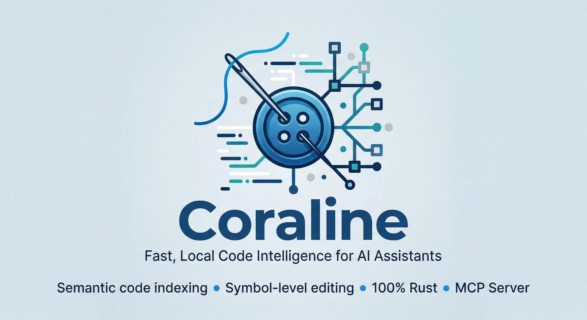

<div align="center">



# Coraline

### Fast, Local Code Intelligence for AI Assistants

**Semantic code indexing • Symbol-level queries • 100% Rust • MCP Server**

[](LICENSE.md)
[](https://www.rust-lang.org/)
[](https://www.bestpractices.dev/projects/13307)

</div>

---

## What is Coraline?

Coraline is a Rust-based code intelligence system that builds semantic knowledge graphs for AI assistants. It combines ideas from [CodeGraph](https://github.com/colbymchenry/codegraph) and [Serena](https://github.com/oraios/serena) to provide:

- ⚡ **Fast indexing** - Native Rust performance for rapid code analysis
- 🧠 **Semantic search** - Find code by meaning using vector embeddings
- 🔧 **Symbol-level queries** - Precise function/class/method lookup,
  callers, callees and impact radius
- 🔒 **100% local** - Your code never leaves the machine. The one
  exception is the optional embedding model, which is downloaded from
  HuggingFace on request (see [Model](#model))
- 🌐 **MCP integration** - Works with Claude Desktop, Claude Code, and OpenCode

Coraline is read-only with respect to your source: it indexes and
queries, it does not edit. The only things it writes are its own
`.coraline/` directory and, via `coraline_write_memory`, the Markdown
notes in `.coraline/memories/`.

## Installation

```bash
# From crates.io (recommended)
cargo install coraline

# Or download pre-built binaries from releases
# https://github.com/greysquirr3l/coraline/releases
```

## Quick Start

```bash
# Initialize and index a project
cd your-project
coraline init -i

# Optional: Download embedding model and generate vectors for semantic search
coraline embed --download

# Start MCP server for AI assistants
coraline serve --mcp
```

### Model

Semantic search needs an embedding model, which Coraline runs locally
via ONNX Runtime. The model is **not** bundled — it is downloaded from
HuggingFace on request:

```bash
coraline model list        # show the available models
coraline model download    # fetch the default model's weights + tokenizer
coraline model status      # show what is present locally
```

`coraline init` offers to download it (globally, into
`~/.config/coraline/models/`, or locally into the project). Pass
`--no-embed` to skip the prompt, or `--embed` to skip it and download
without asking.

Everything else — indexing, the graph queries, the MCP tools — works
without the model. Only `coraline embed` and `coraline_semantic_search`
need it.

### MCP Configuration

Add to your MCP client config:

**Claude Desktop** (`~/Library/Application Support/Claude/claude_desktop_config.json`):
```json
{
  "mcpServers": {
    "coraline": {
      "command": "/path/to/coraline",
      "args": ["serve", "--mcp"]
    }
  }
}
```

**Claude Code** (`.claude/mcp.json` in workspace):
```json
{
  "mcpServers": {
    "coraline": {
      "command": "coraline",
      "args": ["serve", "--mcp"]
    }
  }
}
```

**OpenCode** (`.opencode/config.json` in workspace):
```json
{
  "mcpServers": {
    "coraline": {
      "command": "coraline",
      "args": ["serve", "--mcp", "--timeout", "300000"]
    }
  }
}
```

## CLI Commands

```bash
coraline init [path]                      # Initialize project
coraline index [path]                     # Build code graph
coraline sync [path]                      # Incremental update
coraline status [path]                    # Show project status
coraline stats [path]                     # Graph statistics
coraline doctor [path]                    # Diagnose the local setup
coraline query <search>                   # Search symbols
coraline context <task>                   # Build context for a task
coraline callers <node>                   # Who calls this symbol
coraline callees <node>                   # What this symbol calls
coraline impact <node>                    # Impact radius
coraline audit-docs [path]                # Audit documentation coverage
coraline config <subcommand>              # Read / update configuration
coraline hooks install                    # Auto-sync on git commits
coraline model <subcommand>               # Manage the embedding model
coraline embed [--download]               # Generate semantic embeddings
coraline serve --mcp [--timeout <ms>]     # Start MCP server
```

## MCP Tools

Coraline exposes 38 tools for code intelligence:

**Core Tools**: `coraline_search`, `coraline_callers`, `coraline_callees`, `coraline_impact`, `coraline_context`, `coraline_semantic_search`

**Batch Tools**: `coraline_batch_get_nodes`, `coraline_batch_callers`, `coraline_batch_callees` (60-90% token savings)

**Advanced Search**: `coraline_search_by_signature`, `coraline_search_by_docstring`, `coraline_search_exported_symbols`

**Compact output**: eight tools — `coraline_search`, `coraline_callers`,
`coraline_callees`, `coraline_batch_get_nodes`,
`coraline_search_by_signature`, `coraline_search_by_docstring`,
`coraline_search_exported_symbols` and `coraline_find_by_kind_in_file` —
accept `output_format: "compact"`, which trims null fields and shortens
keys for roughly 30% fewer tokens. The other 30 tools do not take the
parameter.

## Documentation

📖 **[Read the full documentation →](https://greysquirr3l.github.io/coraline/)**

- [Installation & Setup](https://greysquirr3l.github.io/coraline/installation.html)
- [MCP Tools Reference](https://greysquirr3l.github.io/coraline/mcp-tools.html)
- [CLI Reference](https://greysquirr3l.github.io/coraline/cli-reference.html)
- [Configuration Guide](https://greysquirr3l.github.io/coraline/configuration.html)
- [OpenCode Integration](https://greysquirr3l.github.io/coraline/opencode.html)
- [Architecture](https://greysquirr3l.github.io/coraline/architecture.html)

## Supported Languages

36 languages are shipped with tree-sitter grammars. 19 are indexed
end to end today — TypeScript, JavaScript, TSX, JSX, Python, Go, Rust,
Java, C, C++, C#, PHP, Ruby, Swift, Kotlin, Liquid, Blazor, Markdown
and Perl. (Liquid is the odd one out: it has no tree-sitter grammar and
is parsed by hand, so it is the 37th language Coraline knows about but
not one of the 36 that ship a grammar.) The remaining 17 have their
grammar dependency in place but no extraction contract yet, so they
produce no graph nodes; see
[issue #128](https://github.com/greysquirr3l/coraline/issues/128).

[See full language support →](https://greysquirr3l.github.io/coraline/languages.html)

## Contributing

Contributions welcome! See [DEVELOPMENT.md](docs/DEVELOPMENT.md) for build setup and contribution guidelines.

## License

Licensed under either of Apache License 2.0 or MIT license at your option.

## Acknowledgements

Built upon ideas from [CodeGraph](https://github.com/colbymchenry/codegraph) by Colby McHenry and [Serena](https://github.com/oraios/serena) by Oraios AI, using [tree-sitter](https://tree-sitter.github.io/) for parsing.

---

<div align="center">

**Built with Rust for the AI coding community**

[Documentation](https://greysquirr3l.github.io/coraline/) · [Report Bug](https://github.com/greysquirr3l/coraline/issues) · [Request Feature](https://github.com/greysquirr3l/coraline/issues)

</div>
